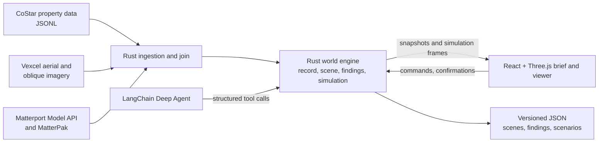

# Technical Stack

## 1. Architecture decision

Build the product as a browser-based building brief and 3D rehearsal viewer
backed by a **Rust world engine**. Rust owns the joined property record, the
canonical scene, provenance and verification status, the occupant/crew
simulation, and saved scenarios. TypeScript renders snapshots of that world
and sends officer actions back as commands.

Every agent proposal and every manual correction passes through the Rust
engine before it can appear in the brief or be used in a simulation.



## 2. Stack at a glance

| Layer | Choice | Purpose |
| --- | --- | --- |
| Web app | React, TypeScript, Vite | Fast client development and static production build |
| 3D | Three.js, React Three Fiber, Drei; Matterport Showcase SDK | Scanned interior, site context, markers, simulation playback, top-down and perspective views |
| UI state | Zustand | Selection, camera, panels, and other UI-only state |
| Server state | TanStack Query | Property record, scene snapshots, findings, scenario runs |
| UI styling | Tailwind CSS | Fast, consistent hackathon UI |
| Core backend | Rust, Axum, Tokio | HTTP/WebSocket API and authoritative world state |
| Geometry | `geo`, `parry2d`, `nalgebra` | Polygons, routes, clearances, intersections, transforms |
| Data model | `serde`, `serde_json`, `uuid`, `ts-rs` | Serialization and generated TypeScript types |
| Persistence | Rust memory + versioned JSON files | Prepared buildings, findings, scenarios, and results without database plumbing |
| AI | LangChain Deep Agents (TypeScript) with a LangChain model provider | Building brief and bounded scenario rehearsal |
| External data | CoStar JSONL, Vexcel imagery, Matterport GraphQL Model API | Property metadata, exterior context, indoor geometry |
| Testing | Rust tests + `proptest`; Vitest; Playwright | Geometry invariants, deterministic simulations, UI flows |
| Packaging | pnpm workspace, Cargo workspace, Docker | Reproducible local and deployed builds |

Pin exact dependency versions in `pnpm-lock.yaml` and `Cargo.lock`; do not pin
versions in this architecture document.

## 3. Data ingestion and join

All source APIs are called from the Rust backend, never from the browser, and
credentials stay server-side. Every imported fact keeps its **source**,
**capture or record date**, and **coverage** so the brief can show where it
came from and how current it is.

### CoStar: property identity and metadata

- Ingest the supplied JSONL data and documented join keys.
- Extract address, coordinates, property type and use, building area, number
  of floors, year built, and any construction, tenancy, or protection fields.
- Treat sparse fields as unknown. Listing and tenant data are context, not
  confirmed occupancy, occupant counts, or contents.

### Vexcel: exterior site context

- Fetch aerial (nadir) and oblique imagery for the property's coordinates.
- Use it for the building footprint, street frontage, apparatus approach, and
  candidate exterior entrances.
- Exterior entrances inferred from imagery are `unverified` findings; imagery
  does not show whether a door is usable, locked, or connected to an interior
  route.
- Cache imagery tiles and record the capture date shown in the brief.

### Matterport: indoor geometry

Call the Matterport Model API:

```text
POST https://api.matterport.com/api/models/graph
Authorization: Basic <token-id:token-secret>
```

For the selected model and floor, retrieve:

- floor and room IDs;
- room classifications and metric dimensions;
- room boundary edges and their vertices;
- edge type (`wall` or `invisible`), thickness/bias, openings, and holes;
- floor elevation and ceiling height when available;
- MatterPak OBJ/MTL/texture asset URLs.

The HackPrinceton organization enables the Property Intelligence room-boundary
extension; the demo model is `zvKHR9DHNjJ`. In ordinary Matterport accounts,
detailed vector data can be enterprise-gated. References:
[Model API overview](https://matterport.github.io/developer-docs/api/model/overview/)
and [Vector Data documentation](https://matterport.github.io/showcase-sdk/modelapi_pi_vector_data.html).

The structured room geometry, not triangles inferred from the OBJ, defines
walls, walkable space, openings, collision, and simulation cells. The
defurnished OBJ and the Showcase SDK textured view are visual layers only.

### Joining sources and recording coverage

1. Match the CoStar property to Vexcel imagery by coordinates and to
   Matterport scans by the documented join keys.
2. Record which floors and areas the scan covers. A scan of one suite must
   never represent the whole building.
3. Register the Matterport floor to the Vexcel footprint (a manual
   two-point alignment is acceptable for the MVP) so interior openings and
   exterior entrances can be related.
4. Everything outside scan coverage is `unknown` and is drawn as such.

### Coordinates and units

- Store every physical quantity in SI units.
- Keep the canonical Rust world in Matterport's Z-up coordinate system.
- Convert Z-up to Three.js Y-up only in the rendering adapter.
- Save the source-to-world and scan-to-site transforms with the scene; never
  apply an unexplained rotation or scale during loading.
- Exits are officer-confirmed data. A Matterport opening may identify a door,
  but it does not prove the door is a usable exterior exit.

## 4. Canonical Rust world engine

The backend holds one authoritative `World` per active building.

```rust
World {
    scene_id,
    revision,
    property,          // CoStar fields + source/date
    site,              // Vexcel imagery refs, footprint, scan-to-site transform
    scan_coverage,     // scanned floors/areas; everything else unknown
    floor_shell,
    walls,
    openings,
    obstacles,         // furniture, storage, fixed equipment footprints
    findings,          // access points, routes, obstacles, verification items
    scenarios,
}
```

Each finding has a kind, geometry (point, polyline, or area), source,
rationale, and status: `unverified`, `confirmed` (by whom and when), or
`rejected`. Only the UI can confirm or reject; agent-created findings are
always `unverified`.

Every edit is a typed command carrying the revision it was based on:

```text
AddObject / MoveObject / RotateObject / RemoveObject   (obstacles)
ProposeFinding / UpdateFinding                          (agent or officer)
ConfirmFinding / RejectFinding                          (officer only)
CreateScenario / UpdateScenario
```

The engine validates a command, applies it, increments the revision, and emits
a compact delta. Stale or invalid commands are rejected with a reason the UI
and agent can show. The same engine functions back manual edits and agent
tools.

The current codebase already implements the obstacle commands, revisioning,
and placement validation (see `docs/AGENT_TOOLS.md`); findings and scenarios
build on the same pattern.

### Shared types

Define scene and command types in Rust and generate TypeScript declarations
with `ts-rs`. Do not maintain independent handwritten Rust and TypeScript
schemas. Use UUIDs for stable identity and a seeded RNG for reproducible runs.

## 5. Brief and 3D viewer

- **Site view:** Vexcel imagery with the footprint, candidate entrances, and
  apparatus approach, and the scanned floor overlaid in its registered
  position.
- **Interior view:** React Three Fiber scene of the floor shell, obstacles,
  and markers, with the defurnished mesh or Showcase SDK textured view as
  context. Unscanned areas are visibly hatched or greyed.
- **Markers:** access points, exits, routes, obstacles, and verification items,
  styled by status (unverified, confirmed, rejected).
- **Editing:** the existing furniture editor (drag, gizmo, live
  `check_edits` validation) is reused for obstacles; markers can be placed and
  confirmed in the view.
- **Playback:** occupants, crews, and hazard zones with a time scrubber and
  side-by-side scenario comparison.

Keep Zustand limited to ephemeral UI state. Canonical content comes from the
Rust snapshot/delta stream and is cached through TanStack Query.

## 6. Scenario simulation

A deterministic, fixed-timestep Rust module (`crates/simulation`). It runs
without the UI; the UI only plays back frames.

### Navigation

1. Rasterize the scanned floor, walls, and obstacle footprints to a shared
   navigation/hazard grid. Cells outside scan coverage are not walkable.
2. Build cost fields to each confirmed exit (and to any unverified exit a
   scenario explicitly assumes) with Dijkstra or A*.
3. Combine global path cost with local reciprocal collision avoidance so
   agents cannot pass through one another, walls, or obstacles.
4. Recompute affected cost fields when the hazard or a blocked route changes.

### Hazard

A scenario places a hypothetical fire origin and a scripted hazard timeline: a
zone that expands through connected cells and openings at a configured rate
and blocks or penalizes routes it covers. Rates are scenario parameters with
ranges, not physics. This is deliberate (see `docs/FIRE_PREPLAN_RESEARCH.md`):
geometry alone cannot predict fire or smoke, and the product must not imply
that it does.

As a stretch goal, a selected scenario can be exported to NIST's
[Fire Dynamics Simulator](https://pages.nist.gov/fds/) input format for
offline engineering review. FDS is never in the interactive loop.

### Occupants

Each occupant is a small state machine with sampled parameters:

```text
unaware → perceives_cue → seeking_info → preparing_or_helping
        → moving_to_exit → rerouting → exited
```

| Parameter | Effect |
| --- | --- |
| Cue strength, alarm delay, pre-movement delay | Respond at different times |
| Familiar exit preference | Favor the main entrance or the way they came in over the nearest exit |
| Group membership | Move together; wait for group members |
| Willingness to assist, mobility | Help slower occupants; vary walking speed |
| Reroute threshold | Switch exits when a route is blocked or congested |

Avoid a universal "panic" behavior; NIST research finds people often act
rationally and help others.

### Firefighter crews

Each crew is a team agent with a task queue and decision gates:

- enters through an assigned access point after a configured arrival time;
- members stay together and traverse known routes;
- performs an assigned task (e.g. primary search of a set of rooms) with
  task-time ranges, ideally from department drill data;
- reports findings (occupants located, areas searched, routes unavailable);
- **reassesses** when its route becomes unavailable, the hazard reaches its
  area, or a task completes, then takes the next task or withdraws.

### Runs and metrics

- Each scenario runs `K` samples with seeds derived from a fixed base seed;
  compared scenarios share the same base seed and `K`.
- Movement uses a 0.1 s timestep; benchmark and cap occupant count for the
  demo floor and hardware. Stream display frames over WebSocket at about
  10 fps.
- Record per sample and aggregate as ranges:
  - time-to-exit distribution and exit usage;
  - bottlenecks (cells or openings with sustained queues);
  - areas no crew reached or searched before cutoff;
  - crew task completion times and reassessment events;
  - occupants still inside at cutoff (never labeled "dead");
  - which assumed unverified items were used.
- **Sensitivity:** `compare_scenarios` reports which differing inputs moved
  each metric the most, so the brief can point to the assumptions worth
  verifying.

## 7. LangChain Deep Agent

Run the LangChain Deep Agent in a small TypeScript service in the pnpm
workspace. It calls the Rust/Axum backend over authenticated server-to-server
HTTP; the browser only calls `POST /api/agent/turn`. Configure the LangChain
model provider separately, with Gemini as the initial provider if hackathon
credits support it.

The agent's tool surface and rules are defined in `PREPLAN_AGENT.md`:

| Tool | Rust engine operation |
| --- | --- |
| `get_property` | Return the joined property record and source coverage |
| `get_scene` | Return geometry summary, obstacles, findings, and revision |
| `propose_findings` | Add or update `unverified` findings with source and rationale |
| `apply_edits` | Validate and atomically apply typed obstacle commands |
| `create_scenario` | Define fire origin, occupants, crews, blocked routes, seed |
| `run_scenario` | Queue a deterministic simulation run |
| `compare_scenarios` | Return metrics with ranges, bottlenecks, and sensitivity |

The model never edits JSON directly, never confirms a finding, and never
receives CoStar, Vexcel, Matterport, model-provider, or backend credentials.
Metrics and sensitivity are computed in Rust, not by the model.

## 8. Backend APIs and state

Axum provides (existing `/api/world/*` editing routes stay as they are):

```text
GET  /api/properties?query=...
GET  /api/properties/:property_id
POST /api/properties/:property_id/import
GET  /api/scenes/:scene_id
POST /api/scenes/:scene_id/commands
GET  /api/scenes/:scene_id/findings
POST /api/scenes/:scene_id/findings/:finding_id/confirm
POST /api/scenes/:scene_id/findings/:finding_id/reject
POST /api/scenes/:scene_id/scenarios
POST /api/scenarios/:scenario_id/runs
GET  /api/runs/:run_id
GET  /api/scenes/:scene_id/compare?scenarios=...
POST /api/agent/turn
WS   /api/scenes/:scene_id/stream
```

Keep active worlds and simulation jobs in Rust memory for the hackathon MVP.
Serialize prepared buildings, findings with their confirmation history,
scenario definitions, seeds, metrics, and optional compressed keyframes to
versioned JSON on save or export.

A database is deliberately deferred. Add SQLite or Postgres when the product
needs multiple departments or users, an audit trail across restarts, or
preplan review cycles.

The Axum binary can serve the compiled Vite app for a single-container demo.

## 9. Repository layout

```text
/
├── apps/
│   ├── web/                 # React, R3F, brief and viewer UI
│   ├── import-scene/        # Matterport import CLI
│   └── agent/               # LangChain Deep Agent and Rust tool bridge (planned)
├── crates/
│   ├── world-core/          # scene types, commands, geometry, validation
│   ├── matterport/          # Matterport GraphQL client and normalization
│   ├── costar/              # CoStar JSONL join and derived scenario assumptions
│   ├── vexcel/              # Vexcel imagery client and site context (planned)
│   ├── simulation/          # hazard, occupant, and crew simulation (planned)
│   └── server/              # Axum API, persistence, streaming
├── scenarios/               # seeded scenario fixtures (planned)
├── data/                    # fixtures, prepared scenes, local exports; generated files gitignored
└── docker/                  # production container files (planned)
```

## 10. Environment variables

```text
MATTERPORT_TOKEN_ID=
MATTERPORT_TOKEN_SECRET=
MATTERPORT_MODEL_ID=zvKHR9DHNjJ
MATTERPORT_SDK_KEY=
VEXCEL_API_KEY=
COSTAR_DATA_PATH=
GEMINI_API_KEY=
DEEP_AGENTS_MODEL=
TFLOP_SERVER_ADDR=127.0.0.1:3000
RUST_LOG=info
```

Commit only `.env.example`. Never expose sponsor credentials through Vite
variables or browser requests (the Showcase SDK key is the one intentional
exception and must be domain-restricted), and never log Basic Auth headers or
signed asset URLs.

## 11. Build order for the hackathon

Already done: Matterport import, canonical scene, obstacle editing with
validation, and the 3D/textured views.

1. Ingest CoStar data and join one property to its Matterport scan; record
   scan coverage.
2. Fetch Vexcel imagery for that property and register the scanned floor to
   the footprint.
3. Add findings (access points, exits, routes, obstacles, verification items)
   with status, and the confirm/reject UI.
4. Implement the brief panel and preplan card.
5. Implement deterministic navigation and the scripted hazard zone.
6. Add the occupant state machine (delay, familiarity, groups, helping,
   rerouting).
7. Add crew agents with tasks and reassessment.
8. Add multi-sample runs, comparison metrics, and sensitivity.
9. Add the Deep Agent with brief and rehearsal modes.
10. Polish the two-scenario comparison demo.

Do not begin with whole-portfolio search, multi-floor simulation, physics-based
fire spread, FDS integration, or automatic semantic decomposition of the mesh.

## 12. Demo success criteria

The stack is working when the team can:

- select a real commercial building and show its CoStar facts, Vexcel site
  view, and bounded Matterport interior, with sources and dates;
- have the agent propose access points, routes, obstacles, and a verification
  list, all marked unverified;
- confirm, reject, or correct those findings in the UI;
- run a hypothetical fire scenario with occupants and a search crew;
- change the fire origin or block a route and rerun with the same seed; and
- compare the two scenarios, showing bottlenecks, unreachable areas, timing
  ranges, and the assumptions that mattered most.
