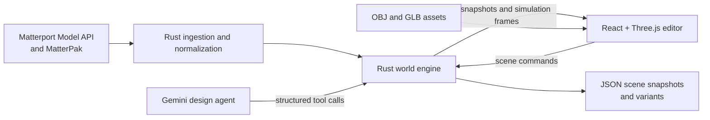

# Technical Stack

## 1. Architecture decision

Build the product as a browser-based 3D editor backed by a **Rust world engine**.
Rust owns the canonical scene, geometry validation, evacuation simulation, fire
simulation, and version history. TypeScript renders snapshots of that world and
sends user actions back as commands.

This is not Rust added for presentation: every generated or manually edited
layout must pass through the Rust engine before it can be simulated or saved.



## 2. Stack at a glance

| Layer | Choice | Purpose |
| --- | --- | --- |
| Web app | React, TypeScript, Vite | Fast client development and static production build |
| 3D | Three.js, React Three Fiber, Drei | Room shell, furniture, controls, animation, top-down and perspective views |
| UI state | Zustand | Selection, camera, panels, and other UI-only state |
| Server state | TanStack Query | Scene snapshots, variants, jobs, and API mutations |
| UI styling | Tailwind CSS and shadcn/ui | Fast, consistent hackathon UI |
| Core backend | Rust, Axum, Tokio | HTTP/WebSocket API and authoritative world state |
| Geometry | `geo`, `parry2d`, `nalgebra` | Polygons, clearances, intersections, and transforms |
| Data model | `serde`, `serde_json`, `uuid`, `ts-rs` | Scene serialization and generated TypeScript types |
| Persistence | Rust memory + versioned JSON files | Prepared scenes, variants, and demo results without database plumbing |
| AI | Gemini REST API via `reqwest`, with function calling | Layout generation and iterative optimization |
| External data | Matterport GraphQL Model API | Floors, rooms, boundaries, walls, openings, dimensions, and asset URLs |
| Testing | Rust tests + `proptest`; Vitest; Playwright | Geometry invariants, deterministic simulations, UI flows |
| Packaging | pnpm workspace, Cargo workspace, Docker | Reproducible local and deployed builds |

Pin exact dependency versions in `pnpm-lock.yaml` and `Cargo.lock`; do not pin
versions in this architecture document.

## 3. Matterport ingestion

### Primary source: structured geometry

Call the Matterport Model API from the Rust backend, never directly from the
browser. Its API key and token remain server-side. The endpoint is:

```text
POST https://api.matterport.com/api/models/graph
Authorization: Basic <key:token>
```

For the selected model and floor, retrieve:

- floor and room IDs;
- room classifications and metric dimensions;
- room boundary edges and their vertices;
- edge type (`wall` or `invisible`), thickness/bias, openings, and holes;
- floor elevation and ceiling height when available;
- MatterPak OBJ/MTL/texture asset URLs.

The HackPrinceton organization enables the Property Intelligence room-boundary
extension. Confirm the fields against model `zvKHR9DHNjJ` during
the first ingestion spike. In ordinary Matterport accounts, detailed vector
data can be enterprise-gated. The relevant official references are the
[Model API overview](https://matterport.github.io/developer-docs/api/model/overview/)
and [Vector Data documentation](https://matterport.github.io/showcase-sdk/modelapi_pi_vector_data.html).

### Visual-reference mesh

Use the MatterPak OBJ as an optional, non-authoritative visual layer:

1. Download and cache the MatterPak on the server.
2. Convert OBJ/MTL/JPEG into a web-optimized GLB during preprocessing.
3. Simplify and compress the mesh if necessary; do not ship a multi-million
   point XYZ cloud in the main demo.
4. Render it with adjustable opacity behind the clean editable room shell.

The structured room geometry—not triangles inferred from the OBJ—defines walls,
walkable space, doors, collision, and simulation cells.

### Coordinates and units

- Store every physical quantity in SI units.
- Keep the canonical Rust world in Matterport's Z-up coordinate system.
- Convert Z-up to Three.js Y-up only in the rendering adapter.
- Save the source-to-world transform with the scene; never apply an unexplained
  rotation or scale during asset loading.
- Treat exits as user-confirmed data. Matterport openings may identify doors,
  but an opening alone does not prove that it is a usable exterior exit.

## 4. Canonical Rust world engine

The backend holds one authoritative `World` per active scene. The web client
does not directly mutate canonical furniture objects.

```rust
World {
    scene_id,
    revision,
    floor_shell,
    walls,
    openings,
    exits,
    furniture,
    materials,
    occupant_profile,
}
```

Every edit is a typed command carrying the revision it was based on:

```text
AddObject
MoveObject
RotateObject
RemoveObject
SetObjectMaterial
ConfirmExit
CreateVariant
ResetVariant
```

The engine validates a command, applies it, increments the revision, and emits
a compact scene delta. Reject stale or invalid commands with a reason the UI and
agent can show. During dragging, Three.js may display a local preview; commit
the transform to Rust on pointer release.

The same engine functions back manual edits and AI tools. This prevents the
agent from bypassing overlap, containment, clearance, or required-seat rules.

### Shared types

Define scene and command types in Rust and generate TypeScript declarations with
`ts-rs`. Do not maintain independent handwritten Rust and TypeScript schemas.
Use UUIDs for stable object identity and a seeded RNG for reproducible runs.

## 5. 3D editor and visualization

Use React Three Fiber rather than manipulating a separate Three.js scene graph
imperatively throughout the application.

Editor capabilities:

- GLB/GLTF furniture assets loaded with Drei's `useGLTF`;
- orbit, pan, zoom, and top-down camera presets;
- raycast selection and transform gizmos;
- floor-constrained translation and rotation snapping;
- translucent clearance footprints and invalid-placement highlighting;
- baseline/variant switcher;
- animated occupants, smoke overlays, burning-object state, and a time scrubber.

Keep Zustand limited to ephemeral UI state. Canonical scene content comes from
the Rust snapshot/delta stream and is cached through TanStack Query.

## 6. Evacuation simulation

Implement the simulation as a deterministic, fixed-timestep Rust module.

1. Rasterize the room polygon, walls, and furniture footprints to a shared
   navigation/hazard grid.
2. Build a cost field from every confirmed exit using Dijkstra or A*.
3. Give each occupant a preferred speed, radius, reaction delay, and familiar
   exit preference drawn from a seeded scenario definition.
4. Combine global path cost with local reciprocal collision avoidance so people
   cannot pass through one another, walls, or furniture.
5. Continuously add heat, smoke, visibility, and congestion penalties to the
   navigation cost. Re-plan when a route becomes hazardous or blocked.
6. Record evacuation time, exit throughput, travel distance, exposure, and
   occupants unable to evacuate before the scenario cutoff.

For the MVP, the occupant count `N` is a scenario parameter rather than a fixed
demo constant. A 0.1-second movement timestep should support typical demo-sized
crowds faster than real time on the server; benchmark and cap `N` based on the
selected room and hardware. Stream display frames over WebSocket at a lower
rate such as 10 frames per second.

Do not label un-evacuated or incapacitated occupants as “dead.” That conclusion
would require a validated tenability and toxicology model.

## 7. Fire simulation

### MVP: physics-informed interactive model

A simple expanding circle is insufficient. Use a deterministic 2.5D cellular
fire model coupled to the room and furniture geometry:

- Divide the floor into horizontal cells and a small number of vertical layers
  representing floor/fuel, occupant height, and the ceiling smoke layer.
- Assign walls and furniture material profiles: ignition temperature, thermal
  conductivity, heat capacity, fuel load, peak heat-release rate, burn rate,
  soot yield, and whether the material is combustible.
- Transfer heat through neighboring surfaces by conduction.
- Apply line-of-sight radiative heating from burning cells and objects.
- Move hot gases and smoke upward, then laterally through connected cells and
  door openings; walls block flow except at openings.
- Ignite a material only after accumulated heat raises it above its ignition
  condition. Burning furniture then becomes a new heat and smoke source.
- Reduce visibility and increase pedestrian route cost based on local smoke,
  temperature, and fire state.

This produces geometry- and material-dependent spread across furniture, walls,
and openings. It is much more credible than radial growth while remaining fast
enough for optimization loops.

### Accuracy boundary

Call this model **physics-informed**, not a validated fire code or CFD model.
Accurate smoke and heat transport is a computational fluid-dynamics problem.
NIST's [Fire Dynamics Simulator](https://pages.nist.gov/fds/) uses large-eddy
simulation for that purpose and is the appropriate comparison point.

As a stretch goal, export a selected layout to an FDS input file and run one
high-fidelity validation scenario asynchronously. Do not put FDS inside the
interactive optimization loop: it is too expensive for rapid multi-variant
search. FDS+Evac is also no longer supported in current FDS releases, so our
pedestrian engine should remain independent.

## 8. Gemini design and optimization agent

Use Gemini function calling through the backend. Keep the model name
configuration-driven so the team can use whichever Gemini tier the hackathon
credits enable. The official [function-calling documentation](https://ai.google.dev/gemini-api/docs/function-calling)
shows the structured tool pattern.

Expose a narrow tool surface:

| Tool | Rust engine operation |
| --- | --- |
| `get_scene` | Return boundaries, exits, objects, constraints, and revision |
| `create_variant` | Fork an immutable baseline into a working variant |
| `apply_edits` | Validate and atomically apply a batch of typed commands |
| `validate_layout` | Return overlaps, clearance failures, seating count, and unreachable areas |
| `simulate_egress` | Queue deterministic fire/evacuation scenarios |
| `compare_variants` | Return normalized metrics and constraint failures |

The backend executes tool calls and returns structured results. The model never
edits JSON blobs directly and never receives Matterport or Gemini credentials.

Optimization should be bounded:

1. Generate a small number of coherent layouts for the requested use case.
2. Reject geometrically or functionally invalid variants before simulation.
3. Run the same seeded scenario set against every valid variant.
4. Let Gemini propose targeted changes based on bottlenecks.
5. Stop at a fixed iteration/time budget.
6. Return the best-performing tested layout while preserving the requested
   capacity, required objects, and intended use.

The scoring function should be implemented in Rust, not invented by the model:

```text
score = evacuation_time
      + exposure_penalty
      + congestion_penalty
      + very_large_constraint_violation_penalty
```

Show each component so the comparison remains explainable.

## 9. Backend APIs and state

Axum provides:

```text
POST /api/matterport/import/:model_id
GET  /api/scenes/:scene_id
POST /api/scenes/:scene_id/commands
POST /api/scenes/:scene_id/variants
POST /api/scenes/:scene_id/simulations
GET  /api/simulations/:run_id
GET  /api/scenes/:scene_id/compare
POST /api/agent/turn
WS   /api/scenes/:scene_id/stream
```

Keep active worlds, variants, and simulation jobs in Rust memory for the
hackathon MVP. Serialize prepared scenes, immutable variant snapshots,
simulation configuration, RNG seeds, metrics, and optional compressed keyframes
to versioned JSON when the user saves or exports. The browser may cache the most
recent scene in local storage for refresh recovery.

A database is deliberately deferred. Add SQLite or Postgres only when the
product needs multi-user accounts, server restarts without losing work,
searchable run history, or concurrent editing. The baseline remains immutable;
reset means switching/forking versions, not reconstructing lost state.

The Axum binary can serve the compiled Vite app for a single-container demo.
This avoids coordinating separate frontend and backend deployments on judging
day.

## 10. Repository layout

```text
/
├── apps/
│   └── web/                 # React, R3F, UI
├── crates/
│   ├── world-core/          # scene types, commands, geometry, validation
│   ├── simulation/          # fire and evacuation engines
│   ├── matterport/          # GraphQL client and normalization
│   └── server/              # Axum API, Gemini loop, persistence, streaming
├── assets/
│   ├── furniture/           # optimized GLB furniture
│   └── prepared-scenes/     # cached demo assets, where licensing permits
├── scenarios/               # seeded simulation fixtures
├── data/                    # local saved scenes and run exports; gitignored
└── docker/                  # production container files
```

## 11. Environment variables

```text
MATTERPORT_API_KEY=
MATTERPORT_API_TOKEN=
GEMINI_API_KEY=
GEMINI_MODEL=
ASSET_CACHE_DIR=./data/assets
RUST_LOG=info
```

Commit only `.env.example`. Never expose sponsor credentials through Vite
variables or browser requests, and never log Basic Auth headers or signed asset
URLs.

## 12. Build order for the hackathon

1. Query `zvKHR9DHNjJ`, normalize one floor, and render the clean room shell.
2. Add five furniture GLBs and Rust-validated move/add/remove commands.
3. Implement saveable baseline and variants.
4. Implement deterministic navigation for configurable `N` occupants.
5. Add material-tagged fire/smoke spread and hazard-aware re-routing.
6. Add Gemini generation through `get_scene`, `apply_edits`, and validation.
7. Add bounded optimize/simulate/compare iteration.
8. Polish the baseline-versus-optimized judging flow.

Do not begin with automatic OBJ semantic decomposition, 15,000-model search,
CoStar joins, multi-floor simulation, or full FDS integration. Those are useful
follow-ons but are not on the critical path to the demo described in the PRD.

## 13. Demo success criteria

The stack is working when the team can:

- load a prepared Matterport-derived commercial room;
- ask Gemini for a layout matching an arbitrary use case and capacity;
- manually move an object through the same Rust command path;
- start a material- and geometry-dependent fire scenario;
- watch `N` collision-aware occupants react and evacuate;
- optimize several variants against identical seeded scenarios; and
- compare the immutable baseline with the best tested valid layout.
